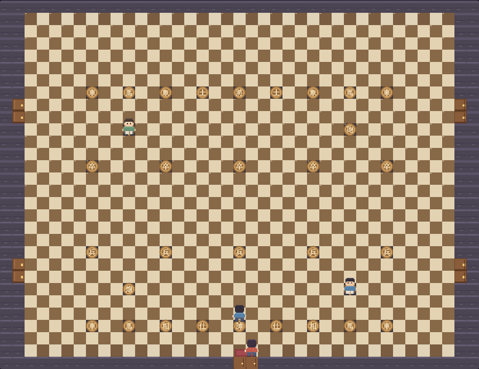
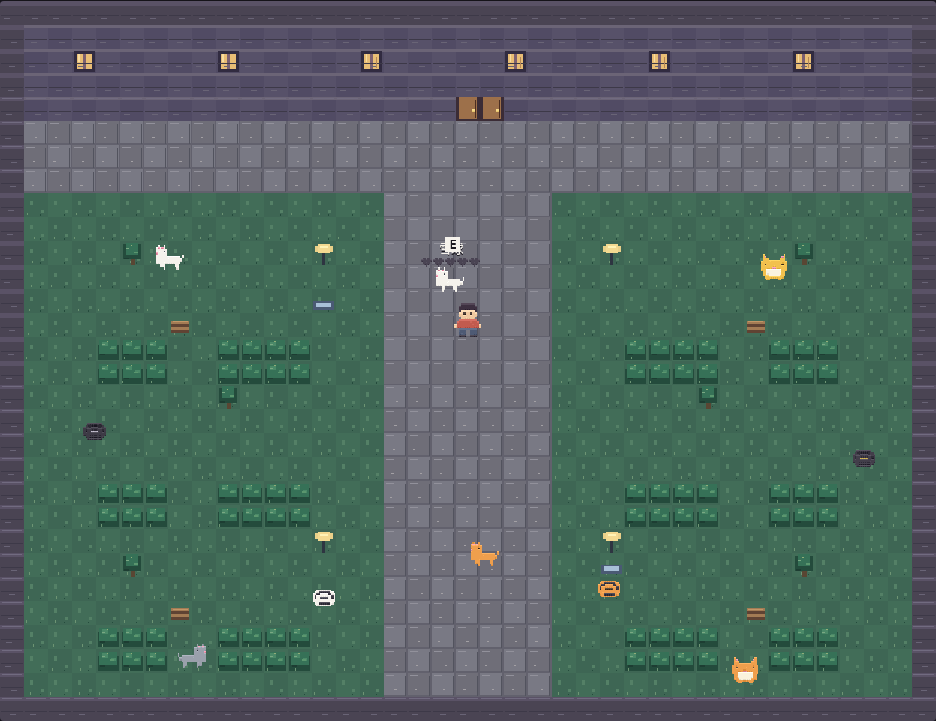
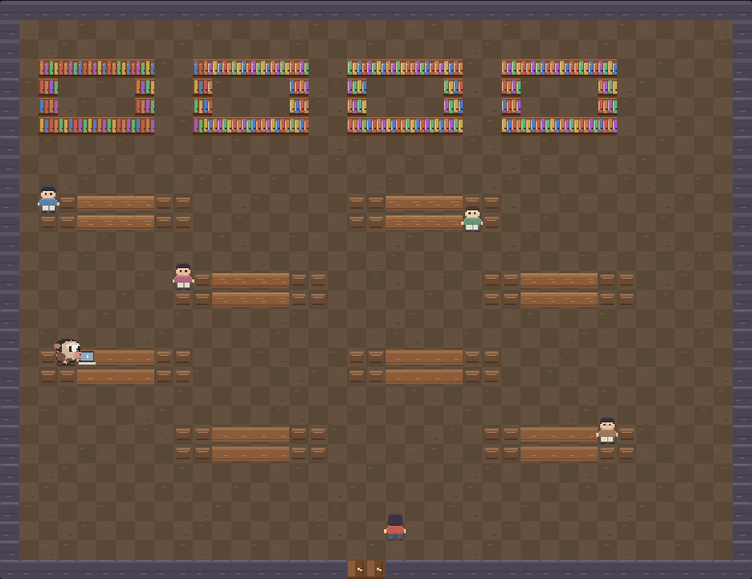

# NoteGame

**把日记与回忆中的人、动物和场景，做成可以亲自走进去的互动小游戏。**

NoteGame 是一个持续创作的个人游戏项目。它以真实的记忆为灵感，用像素场景和轻量互动记录那些值得再次遇见的人与事。当前可玩的内容是发生在夜晚图书馆的第一段故事。

## 当前游戏：图书馆的夜晚

第一段故事发生在夜晚的图书馆——它还原的是我就读的学校。

前庭等待相遇的 11 只猫里，奶牛猫咪咪是我曾经养过的猫。它后来躲进了图书馆附近，变得非常怕人。所以游戏里它一看见人就会逃进树丛，只能远远地把食物放在地上，或放进前庭的碗里等它自己来。

阅览室里准备建模比赛的小蠹鱼是我的一位网友。她是一个非常努力的女孩子，曾给我抱怨过数学建模比赛好累。游戏里她还在那里备战，靠近时会听到她说话。

玩家可以在中庭、阅览室、卫生间和图书馆前庭自由走动。前庭有 11 只等待相遇的猫，其中奶牛猫咪咪怕人、爱吃猫粮，还会突然乱跑。阅览室里有准备建模比赛的小蠹鱼；其他学生在读书，也有人从馆内进出。这里没有通关压力，重点是探索、观察和互动。

## 操作

| 按键 | 操作 |
| --- | --- |
| WASD 或方向键 | 移动 |
| E | 进出房间、投喂猫、往空碗放猫粮 |
| M | 静音或恢复音乐 |

靠近普通猫可按 **E** 投喂。咪咪需要从远处放下食物，或把猫粮放进前庭的碗里；它看见人会逃进树丛。靠近小蠹鱼时会听到她说话。其他角色偶尔也会投喂普通猫，但不计入玩家的撸猫进度。

## 游戏画面

| 中庭 | 前庭 | 阅览室 |
| --- | --- | --- |
|  |  |  |

## 本地运行

项目是纯 HTML、Canvas 和原生 JavaScript（ES Modules），无需安装运行依赖。浏览器对 ES Modules 有限制，双击打开 `index.html` 无法运行，需要在项目目录启动本地服务器：

```bash
python3 -m http.server 8137
```

然后访问 `http://localhost:8137`。运行测试使用 `npm test`。

## 部署到 GitHub Pages

仓库已配置 GitHub Actions 工作流。推送到 `main` 后，它会运行测试、生成 `_site/`，并部署游戏文件。发布目录只包含 `index.html`、`style.css`、`src/` 和 `assent/`；本地参考图、文档和测试不会进入网站。

首次发布时，在 GitHub 仓库的 **Settings → Pages → Build and deployment** 中把 **Source** 设为 **GitHub Actions**。如果首次推送先于这项设置，可在 **Actions → Deploy game to GitHub Pages** 中手动重新运行。发布前请确认背景音乐的公开使用权限。

本地可执行 `npm run build:pages` 检查发布目录。

## 项目结构

| 路径 | 内容 |
| --- | --- |
| `index.html`、`style.css` | 页面与游戏界面 |
| `src/` | 游戏机制：渲染、角色行为、互动与音频 |
| `src/data/` | 内容数据：场景地图（`data/maps/`）与音频配置（`data/audio.js`） |
| `src/assent/` | 背景音乐 |
| `deploy/` | 部署构建脚本与测试 |

地图为 39×30 格，每格以 32×32 绘制像素呈现；移动和碰撞保留每格 16 单位的世界坐标。
